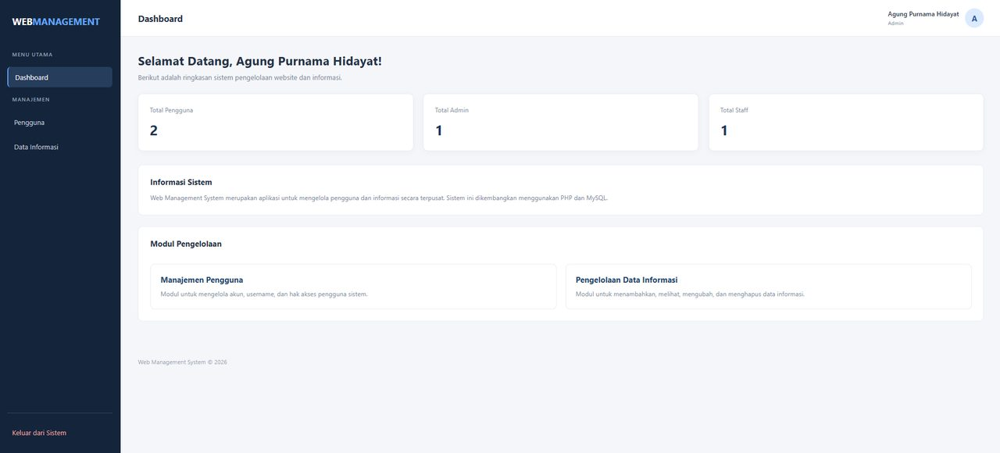
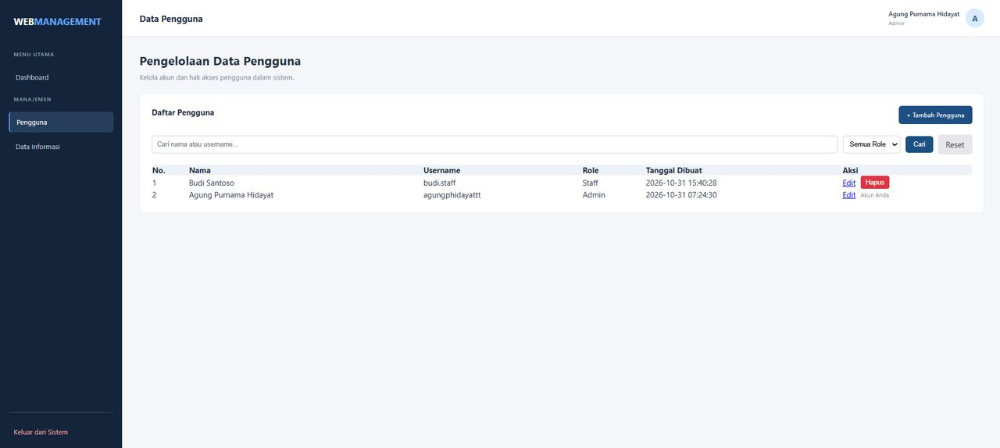
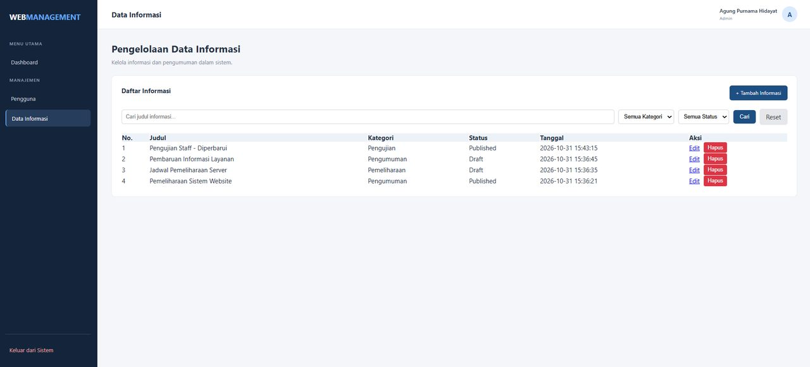

# Web Management System

Aplikasi manajemen berbasis web untuk mengelola informasi dan pengguna, dibangun dengan PHP dan MySQL. Mendukung dua peran (Admin dan Staff) dengan pembatasan akses berdasarkan peran.

## Fitur
- Login dan logout dengan session handling; password disimpan dengan hash (`password_hash`).
- Pembatasan akses berdasarkan peran:
  - **Admin**: mengelola pengguna (tambah, ubah, hapus) dan informasi, termasuk menghapus informasi.
  - **Staff**: menambah dan mengubah informasi.
- CRUD data **Informasi** (judul, kategori, isi, status Draft/Published) dengan pencarian dan filter kategori/status.
- CRUD data **Pengguna** dengan pencarian dan filter peran.
- Dashboard ringkasan jumlah pengguna.
- Perlindungan CSRF pada proses hapus dan pada form pengguna, serta prepared statement untuk query database.

## Tampilan Aplikasi

**Dashboard**



**Pengelolaan Pengguna** (pencarian dan filter role)



**Pengelolaan Informasi** (pencarian, filter kategori dan status)



## Teknologi
PHP, MySQL (MySQLi), HTML, CSS

## Menjalankan di komputer lokal (XAMPP)
1. Pasang XAMPP, lalu jalankan **Apache** dan **MySQL**.
2. Salin folder proyek ini ke `C:\xampp\htdocs\web-management-system`.
3. Buka `http://localhost/phpmyadmin`, pilih tab **Import**, lalu impor file `database.sql`.
4. Jika perlu, sesuaikan kredensial database di `config/database.php` (bawaan XAMPP: user `root`, password kosong).
5. Buka `http://localhost/web-management-system/` di browser.

## Akun demo
| Username | Password   | Peran |
|----------|------------|-------|
| admin    | Admin12345 | Admin |

Akun ini hanya untuk percobaan lokal. Ganti passwordnya jika aplikasi dipasang di server publik.

## Struktur folder
```
web-management-system/
├── assets/css/style.css
├── config/database.php
├── docs/screenshots/
├── informasi/      (index, tambah, edit, delete)
├── pengguna/       (index, tambah, edit, delete)
├── dashboard.php
├── login.php
├── logout.php
├── index.php
└── database.sql
```
